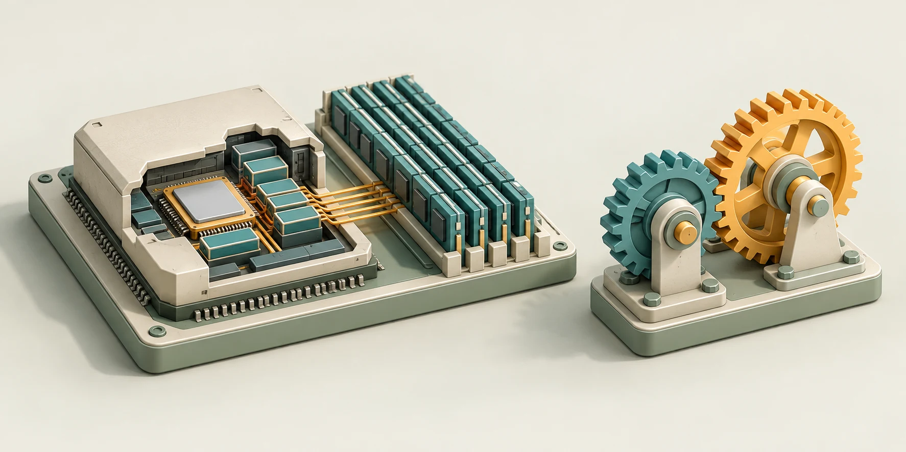
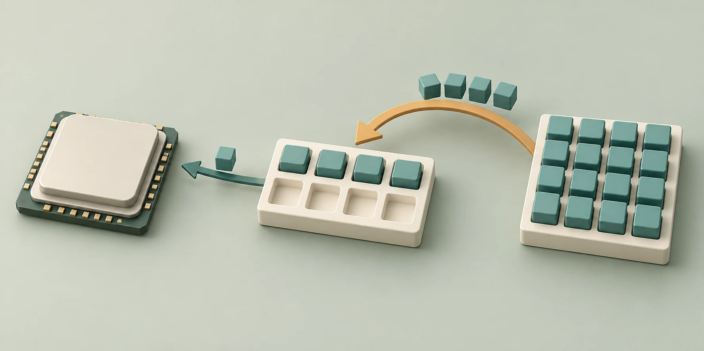

# Mechanism Lab · Three.js Teacher

[中文](README.md) · **English**

Turn a topic into a 3D lesson you can observe, manipulate, and test.



> Both illustrations are AI-generated concept art, not application screenshots. Run the examples in this repository to see the actual interface and behavior.

`threejs-teacher` is a skill for AI coding tools. Describe what you want to learn; the agent researches the mechanism, designs a step-by-step explanation, builds a Three.js scene and meaningful controls, and delivers a standalone web project with verification results.

**The coding agent generates the lesson. The resulting website runs without an AI API, account, or backend.** The included lessons and default interface are in Chinese; repository documentation is available in Chinese and English.

## What it does

- **Makes mechanisms visible:** structures, motion, data paths, and synchronized values explain cause and effect, with 2D diagrams where useful.
- **Lets learners experiment:** orbit the scene, pause, seek, move between steps, change parameters, and predict outcomes.
- **Keeps the interface simple:** a large scene, one key explanation, playback, and step controls; parameters, data, and detailed notes expand on demand.
- **Keeps state reproducible:** visuals and values share one model, including rewind, replay, and parameter resets.
- **Stays portable:** a standard `SKILL.md`, relative references, and a self-contained starter without a proprietary MCP dependency.

## Quick start

Requirements: **Node.js 22.12+**, npm, and a modern browser with WebGL 2. Run all commands below from the repository root.

### CPU cache lesson

```sh
npm ci --prefix examples/cpu-cache
npm run dev
```

The default address is `http://127.0.0.1:5173/`. If that port is occupied, use the address printed by the terminal.

### Gear ratio lesson

```sh
npm ci --prefix examples/gear-ratio
npm run dev:gears
```

The default address is `http://127.0.0.1:5174/`. Run the two examples in separate terminals if you want both open.

The root package only contains convenience scripts. Install dependencies in each lesson directory; a separate root installation of the same dependencies is unnecessary.

## Included lessons

| Lesson | Concepts | Controls | Model |
| --- | --- | --- | --- |
| [CPU cache](examples/cpu-cache/lesson.md) | Hits and misses, block fills, locality, LRU eviction | Two/four cache lines; sequential/interleaved reads | One read-only, fully associative cache |
| [Gear ratio](examples/gear-ratio/lesson.md) | Rotation direction, tooth ratio, input/output speed | Tooth counts, input rpm, input direction | Ideal external spur gears |
| [Starter lever example](skills/threejs-teacher/assets/starter/lesson.md) | Lever arms and torque balance | Effort-arm length | A working starting point to replace |



The cache lesson makes an invisible read observable: a miss copies a whole block, and later reads may hit. Locations, sizes, and paths in this illustration are conceptual, not a physical chip layout.

## Install and invoke the skill

Copy the entire [`skills/threejs-teacher`](skills/threejs-teacher/SKILL.md) directory into a skill location supported by your tool. Keep `references/`, `scripts/`, and `assets/` together.

| Tool | Personal installation location | Invocation |
| --- | --- | --- |
| Codex | `~/.agents/skills/threejs-teacher/`, or an existing `~/.codex/skills/` directory | `$threejs-teacher` |
| Claude Code | `~/.claude/skills/threejs-teacher/` | `/threejs-teacher` |
| Gemini CLI | `~/.gemini/skills/threejs-teacher/` or `~/.agents/skills/threejs-teacher/` | Enable the skill, then request `threejs-teacher` by name |

Discovery and refresh behavior varies by tool. See the [installation notes](skills/threejs-teacher/references/installation.md). These are installation instructions; the repository does not automatically configure your tools.

Example request:

```text
Use threejs-teacher to build a beginner-friendly interactive lesson about
electromagnetic induction. Show a coil, a magnet, and current direction in
Three.js. Let me reverse the magnet's motion, predict the outcome, and test it.
Keep the interface simple. Deliver source, a static build, and verification results.
```

The tool must be able to read/write files and run commands. Browser access is used for visual checks. A chat-only tool cannot independently build and verify the project. You can also ask a coding agent to read `SKILL.md` directly and follow its workflow.

## Create a lesson

```sh
node skills/threejs-teacher/scripts/create-lesson.mjs examples/my-lesson
npm ci --prefix examples/my-lesson
npm --prefix examples/my-lesson run dev
```

The script only writes into a new or empty directory and refuses to overwrite existing content. The new project initially contains the lever example; scaffolding alone does not call an AI or generate a new topic.

Have the agent follow the skill and replace:

| File | Responsibility |
| --- | --- |
| `src/lesson.ts` | Learning goals, steps, parameters, prediction questions, and the 3D scene |
| `src/model.ts` | Mechanism calculations or event traces, separate from rendering |
| `src/model.test.ts` | Core behavior and meaningful edge cases |
| `lesson.md` | Sources, assumptions, run instructions, and acceptance results |

The shared runtime handles playback, the camera, expandable controls, and state synchronization. See the [runtime contract](skills/threejs-teacher/references/runtime.md) and [teaching guide](skills/threejs-teacher/references/teaching-design.md), currently written in Chinese.

## Test and build

After installing the relevant example dependencies, run from the root:

```sh
npm run test:cpu
npm run test:gears
npm run build:cpu
npm run build:gears
```

Builds run TypeScript checks first. Each lesson produces a `dist/` directory with relative asset paths, suitable for an HTTP static server. No particular hosting provider or GitHub Pages setup is required.

Preview the CPU production build:

```sh
npm --prefix examples/cpu-cache run preview
```

The models have five CPU tests and seven gear tests. Checks also covered step changes, pause, seek, parameter resets, dynamic predictions, and desktop/tablet/mobile layouts. See the [verification record](docs/Verification.md). New topics need their own model and visual validation.

## Repository layout

```text
skills/threejs-teacher/   Skill, references, scaffolding script, standalone starter
examples/cpu-cache/      CPU cache lesson
examples/gear-ratio/     Gear ratio lesson
docs/images/            README illustrations and generation prompts
docs/                   Illustrations, prompts, and verification notes
```

## Models and assets

- The CPU example omits multiple cache levels, prefetching, parallelism, writes, and coherence. It does not predict real hardware performance.
- The gear example omits friction, backlash, inertia, and load. Its tooth geometry is not for manufacturing.
- The default workflow does not include narration, video export, or a course management system.
- Lessons should cite sources for formulas, units, and assumptions, and distinguish visual metaphors from physical mechanisms.
- Illustrations were generated with the built-in image tool. Prompts are recorded in [`docs/images/prompts.json`](docs/images/prompts.json). The README uses local WebP assets rather than externally hosted images.

## License

No root project license has been specified. Third-party assets retain their respective licenses:

- [Three.js — MIT](examples/cpu-cache/public/licenses/three-MIT.txt)
- [IBM Plex — SIL Open Font License](examples/cpu-cache/public/licenses/IBM-Plex-OFL.txt)
